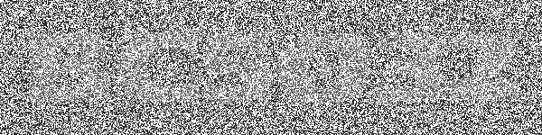
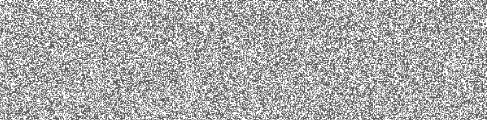

# GHOST CAPTCHA
A Python prototype for generating **human-legible, ML-hardened CAPTCHA challenges** using animated binary pixel noise and dualistic motion.

Instead of relying on static text warping alone, `GhostCaptcha` renders a reference text image and synthesizes multi-frame GIF animations where character pixels and background pixels evolve under opposing horizontal noise shifts—making individual frames noisy while keeping the text perceivable in motion.

## GHOST CAPTCHA (.gif)


## GHOST CAPTCHA appearance when paused or screenshotted


### As evident from the above two figures, GHOST CAPTCHA is AI-proof because it relies on motion parallax and temporal obfuscation—shifting 'text-region noise' and 'background noise' in opposing directions across multiple frames—so that any single static screenshot is completely degraded by random pixel static and unreadable by standard OCR or image-recognition models, while the human visual cortex easily integrates the motion over time to effortlessly perceive the moving text.

## Features

- **Custom & Auto-Generated Codes:** Pass a fixed `captcha_text` (default `"1412"`) or set `auto_generate=True` to sample a 6-character challenge from uppercase letters (`A–Z`) and digits (`0–9`).
- **Automatic Font Scaling:** Dynamically sizes `RES\Sekuya-Regular.ttf` so the rendered text maintains at least a 4% padding margin on both width and height.
- **Motion Frame Generators:**
  - `generate_frame_dualistic_motion`: Shifts background noise rightward (`noise_downward`) while shifting text-region noise leftward (`noise_upward`) across frames.
  - `generate_frame_stop_motion`: Generates independent per-frame binary noise across the canvas while locking sampled pixel states on text coordinates.
- **GIF Export:** Saves animated output to `output_animation.gif` in the working directory and prints the generated code to stdout.

## Project Structure

```text
.
├── RES/
│   └── Sekuya-Regular.ttf   # TrueType font used to render reference text
├── ghost_captcha.py         # GhostCaptcha implementation (adjust filename as needed)
└── output_animation.gif     # Generated animated CAPTCHA output
```

## Requirements

- Python 3.8+
- [Pillow](https://python-pillow.org/) (`PIL`)

Install dependencies:

```bash
pip install pillow
```

## Quick Start

Ensure `RES\Sekuya-Regular.ttf` exists relative to your current working directory, then run your script:

```bash
python ghost_captcha.py
```

By default, the script runs:

```python
GC = GhostCaptcha(auto_generate=True, frame_count=100, height=150, width=600)
GC.generate_gif()
```

This writes `output_animation.gif` and prints the 6-character CAPTCHA string to the console.

## Usage Examples

### Fixed Text Challenge

```python
from ghost_captcha import GhostCaptcha

captcha = GhostCaptcha(
    captcha_text="7X9K",
    width=600,
    height=150,
    frame_count=60,
    auto_generate=False,
)
captcha.generate_gif()
```

### Using Stop-Motion Mode

By default, `generate_gif()` uses `generate_frame_dualistic_motion`. To switch to stop-motion noise, update `generate_gif()` in your class:

```python
frames = self.generate_frame_stop_motion(ref_image)
```

## API Overview (`GhostCaptcha`)

| Parameter / Method | Description |
| :--- | :--- |
| `frame_count` | Number of animation frames to generate (default: `5`). |
| `height`, `width` | Output image dimensions in pixels (default: `150` × `600`). |
| `captcha_text` | Explicit challenge string used when `auto_generate=False` (default: `"1412"`). |
| `auto_generate` | When `True`, generates a 6-character alphanumeric string via `auto_generate_captcha()`. |
| `generate_ref_image()` | Renders centered black text on a white canvas using `RES\Sekuya-Regular.ttf`. |
| `generate_frame_stop_motion(ref_image)` | Builds a list of `PIL.Image` frames using static per-pixel text masks and dynamic background noise. |
| `generate_frame_dualistic_motion(ref_image)` | Builds a list of `PIL.Image` frames with opposing horizontal noise shifts for text vs. background. |
| `generate_gif()` | Generates frames, saves `output_animation.gif` (`duration=10` ms, `loop=0`), and prints `self.captcha_text`. |

## Notes & Caveats
> GhostCaptcha is still an early prototype and comes with several key nuances to consider: when rendered at smaller dimensions, the text becomes extremely difficult to recognize through the pixel noise; furthermore, font selection is critical because many typefaces fail to provide a distinct separation between the letter "O" and the digit "0", while other fonts feature strokes that are simply too thin for effective human perception and motion integration.
